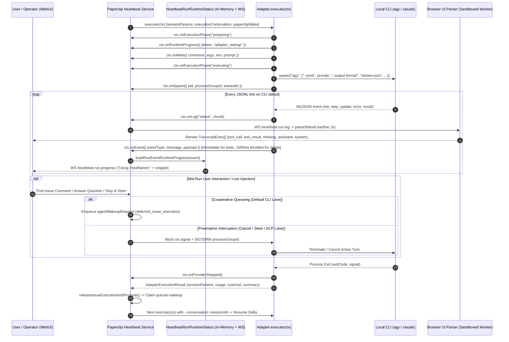
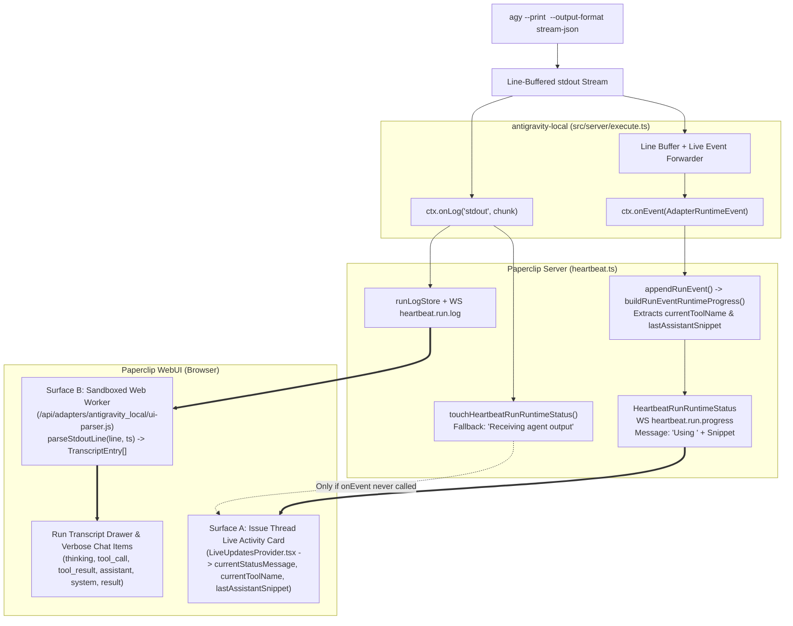

# Design Specification: Paperclip Adapter Contract for Live Task Interaction, Mid-Run Injection, and Streaming Telemetry (`@paperclipai/adapter-antigravity-local`)

- **Document Version:** 1.2 (Approved Baseline Specification + Phase 6 Run Transcript & Sandboxed Worker Resolution)
- **Target Adapter:** [`@paperclipai/adapter-antigravity-local`](file:///Users/dunk/Documents/adapter-antigravity-local/package.json) (`v2.6.0` $\rightarrow$ `v2.7.3` / Phase 5 & Phase 6)
- **Reference Implementations:**
  - [`@paperclipai/adapter-claude-local`](file:///Users/dunk/Documents/paperclip/packages/adapters/claude-local/src/server/execute.ts)
  - [`@paperclipai/adapter-cursor-local`](file:///Users/dunk/Documents/paperclip/packages/adapters/cursor-local/src/ui/parse-stdout.ts)
  - [`paperclip-runner` UI Adapter](file:///Users/dunk/Documents/paperclip/ui/src/adapters/paperclip-runner/index.ts)
  - [`@paperclipai/adapter-utils`](file:///Users/dunk/Documents/paperclip/packages/adapter-utils/src/types.ts) & [`heartbeat.ts`](file:///Users/dunk/Documents/paperclip/server/src/services/heartbeat.ts)
- **Target CLI Version:** Google Antigravity CLI (`agy`) `v1.3.6+`

---

## 1. Purpose & Scope

This specification defines the architectural contract between the **Paperclip Server / WebUI** and a local CLI adapter—specifically [`@paperclipai/adapter-antigravity-local`](file:///Users/dunk/Documents/adapter-antigravity-local/src/index.ts)—for handling **live task execution**, **real-time telemetry streaming**, and **mid-run user interaction / live injection**.

It serves three primary objectives:
1. **Explain Paperclip's Adapter Abstraction**: Document how Paperclip ([`@paperclipai/adapter-utils`](file:///Users/dunk/Documents/paperclip/packages/adapter-utils/src/types.ts) and [`heartbeat.ts`](file:///Users/dunk/Documents/paperclip/server/src/services/heartbeat.ts)) orchestrates a running task, surfaces live status/transcript updates, and handles incoming user messages or control signals while an agent process is actively running.
2. **Establish the Baseline Architecture for `antigravity-local`**: Pinpoint why the Paperclip WebUI stays stuck on `"Receiving agent output"` during `agy` execution and specify the exact contract changes for `v2.7.0` (Phase 5).
3. **Provide a Long-Term Review & Upgrade Baseline**: Compare `claude-local` (CLI & ACP lanes), `paperclip-runner` / `cursor-local`, current `antigravity-local` (`v2.6.0`), and `antigravity-local` (`v2.7.0`), alongside a checklist for evaluating future `agy` CLI releases (`v1.3.7+` / `v1.4.x`).

---

## 2. Paperclip's Adapter Abstraction for Running Tasks

In Paperclip, a local adapter does **not** own the issue queue, WebSocket broadcaster, or database state directly. Instead, the Paperclip heartbeat orchestrator ([`heartbeat.ts`](file:///Users/dunk/Documents/paperclip/server/src/services/heartbeat.ts)) invokes [`ServerAdapterModule.execute(ctx: AdapterExecutionContext)`](file:///Users/dunk/Documents/paperclip/packages/adapter-utils/src/types.ts#L502-L547) and interacts with the running CLI exclusively through the callbacks, signals, and envelopes on [`AdapterExecutionContext`](file:///Users/dunk/Documents/paperclip/packages/adapter-utils/src/types.ts#L341-L370).



### 2.1 Core Lifecycle Callbacks on `AdapterExecutionContext`

The contract in [`packages/adapter-utils/src/types.ts`](file:///Users/dunk/Documents/paperclip/packages/adapter-utils/src/types.ts#L341-L370) defines the following interaction channels between the adapter and Paperclip while a task is running:

| Context Property / Callback | Direction | Purpose in Paperclip Runtime Contract |
| :--- | :--- | :--- |
| [`ctx.onMeta(meta)`](file:///Users/dunk/Documents/paperclip/packages/adapter-utils/src/types.ts#L353) | Adapter $\rightarrow$ Server | Records the exact invocation metadata (`adapterType`, `command`, `cwd`, `commandArgs`, redacted `env`, `prompt`, `context`) in the run log before/at process spawn. |
| [`ctx.onRuntimeProgress(update)`](file:///Users/dunk/Documents/paperclip/packages/adapter-utils/src/types.ts#L356) | Adapter $\rightarrow$ Server | Emits coarse lifecycle phase updates ([`RuntimeStatusPhase`](file:///Users/dunk/Documents/paperclip/packages/adapter-utils/src/runtime-progress.ts#L1-L11): `git_sync`, `config_sync`, `adapter_startup`, `restore`, `export`, `finalize`, `run_activity`). |
| [`ctx.onSpawn(meta)`](file:///Users/dunk/Documents/paperclip/packages/adapter-utils/src/types.ts#L354) | Adapter $\rightarrow$ Server | Registers the OS `pid` and `processGroupId` in Paperclip's [`runningProcesses`](file:///Users/dunk/Documents/paperclip/packages/adapter-utils/src/server-utils.ts#L60) registry so Paperclip can track liveness and deliver `SIGTERM`/`SIGKILL` on cancellation or server restart recovery. |
| [`ctx.onCancellationReady(fn)`](file:///Users/dunk/Documents/paperclip/packages/adapter-utils/src/types.ts#L358) | Adapter $\rightarrow$ Server | Registers a cooperative cancellation handler (used primarily by persistent/ACP session engines to cancel an in-flight turn cleanly before hard process termination). |
| [`ctx.onExecutionPhase(phase)`](file:///Users/dunk/Documents/paperclip/packages/adapter-utils/src/types.ts#L357) | Adapter $\rightarrow$ Server | Marks whether the run is in `"preparing"` (setup/config/handoff) or `"executing"` (active model turn), governing how cancellation and recovery classify the run. |
| [`ctx.onLog(stream, chunk)`](file:///Users/dunk/Documents/paperclip/packages/adapter-utils/src/types.ts#L352) | Adapter $\rightarrow$ Server | Streams raw `stdout`/`stderr` chunks to `runLogStore` and broadcasts `heartbeat.run.log` to connected browser clients for transcript rendering. |
| [`ctx.onEvent(event)`](file:///Users/dunk/Documents/paperclip/packages/adapter-utils/src/types.ts#L355) | Adapter $\rightarrow$ Server | **Critical for Live UI Status**: Emits structured [`AdapterRuntimeEvent`](file:///Users/dunk/Documents/paperclip/packages/adapter-utils/src/types.ts#L329-L339) objects (`eventType`, `message`, `payload`, `detail`) that Paperclip persists to `heartbeatRunEvents` and translates into real-time tool/assistant status banners. |
| [`ctx.signal`](file:///Users/dunk/Documents/paperclip/packages/adapter-utils/src/types.ts#L361) | Server $\rightarrow$ Adapter | `AbortSignal` triggered when an operator cancels/stops a run or when a preemptive control action interrupts the active turn. |
| [`ctx.onProviderStopped()`](file:///Users/dunk/Documents/paperclip/packages/adapter-utils/src/types.ts#L360) | Adapter $\rightarrow$ Server | Notifies Paperclip immediately when the underlying provider/CLI process has stopped generating and settled its side effects. |

---

## 3. How Paperclip Handles "Live Injection" While a Task is Running

A central question in local CLI adapter design is: **How does user interaction ("live injection" of new comments, answers to blocking questions, or steering instructions) reach the agent when a task is already running?**

Paperclip supports **two execution paradigms** for local adapters, plus an **in-turn pull/push API channel**:

### 3.1 Paradigm 1: Single-Turn Process CLI Lane (`claude-local` CLI mode, `kimi-local`, `antigravity-local`)

When running local CLIs in non-interactive print mode (`claude --print --output-format stream-json` or `agy --print <prompt> --output-format stream-json`):
- **Process Stdin Contract**: [`runChildProcess`](file:///Users/dunk/Documents/paperclip/packages/adapter-utils/src/server-utils.ts#L4880-L4886) spawns the CLI with `stdio: ["pipe", "pipe", "pipe"]`, writes any stdin payload, and immediately calls `stdin.end()`. Neither `claude --print` nor `agy --print` accepts multiplexed user messages over `stdin` mid-turn after `stdin` EOF.
- **How Paperclip Achieves Live Injection (Coalesced Wakeup + Session Resume Delta)**:
  1. **Single-Flight Issue Lock & Wakeup Queue**: While Run $N$ is executing on an issue, any new comment (`issue_comment_created`), `@`-mention (`issue_comment_mentioned`), or question response posted by a user creates an `agentWakeupRequest` in [`heartbeat.ts`](file:///Users/dunk/Documents/paperclip/server/src/services/heartbeat.ts#L21100-L21250) with status `deferred_issue_execution` (or `queued`). Multiple comments arriving while Run $N$ is active are coalesced into the pending wakeup payload.
  2. **Immediate Continuation on Turn Boundary (or Preemption)**:
     - **Cooperative Completion**: As soon as Run $N$ finishes its current turn, [`releaseIssueExecutionAndPromote`](file:///Users/dunk/Documents/paperclip/server/src/services/heartbeat.ts#L24450-L24600) atomically promotes the deferred wakeup into Run $N+1$.
     - **Preemptive Steer / Stop-and-Inject**: If the user explicitly stops/cancels Run $N$ ([`cancelRunInternal`](file:///Users/dunk/Documents/paperclip/server/src/services/heartbeat.ts#L29608)) to inject urgent steering, Paperclip aborts `ctx.signal` and kills the tracked process group (`runningProcesses` via `SIGTERM` $\rightarrow$ `graceSec` $\rightarrow$ `SIGKILL`), preserving the session ID from the interrupted run (`interruptedRunId`) so Run $N+1$ resumes cleanly.
  3. **Delta-Only Prompt Injection via `paperclipWake` & `executionContinuation`**:
     - When Run $N+1$ starts with a valid `sessionId` (`resumedSession = true`), the adapter calls [`selectPaperclipPromptSections(context, { resumedSession: true })`](file:///Users/dunk/Documents/paperclip/packages/adapter-utils/src/server-utils.ts#L2195-L2213) and [`renderPaperclipWakePrompt(context.paperclipWake, { resumedSession: true })`](file:///Users/dunk/Documents/paperclip/packages/adapter-utils/src/server-utils.ts#L2117-L2193).
     - Instead of re-sending the entire task prompt and system instructions, the adapter passes `--conversation <sessionId>` to `agy` along with a compact **`## Paperclip Resume Delta`** containing **only** the newly injected user comments, human responses (`ctx.executionContinuation.resumeDelta`), or interrupted-run recovery context.
  4. **Lazy Fresh-Session Handoff Fallback (`hydrateFreshSessionHandoff`)**:
     - If the CLI session cannot be resumed (e.g., first run, cwd changed, or `--conversation` failed with an unknown/corrupted session error), the adapter invokes [`hydrateFreshSessionHandoff(ctx)`](file:///Users/dunk/Documents/paperclip/packages/adapter-utils/src/server-utils.ts#L2195), which calls `ctx.getFreshSessionHandoff()` to hydrate `paperclipWake.latestCommentSummary` and `sessionHandoffMarkdown` so the newly spawned session still receives full continuity.

### 3.2 Paradigm 2: Persistent / ACP Duplex Lane (`claude-local` when `adapterConfig.engine === "acp"`)

Paperclip also provides a shared Agent Client Protocol engine ([`@paperclipai/adapter-utils/acpx-engine`](file:///Users/dunk/Documents/paperclip/packages/adapter-utils/src/acpx-engine/execute.ts)):
- Uses an ACP runtime (`runtime.ensureSession`, `runtime.startTurn({ handle, text, signal })`).
- Registers `ctx.onCancellationReady()` to call `activeTurn.cancel({ reason: "abort" })` cooperatively when `ctx.signal` fires, returning `executionRecovery: { kind: "interrupted", providerStopped: true, sessionPreserved: true, actionOutcomes: "settled" }`.
- **Applicability to `agy` CLI `v1.3.6`**: As verified against the `agy` `v1.3.6` binary, `agy` currently exposes headless execution via `agy --print <prompt> --output-format stream-json --conversation <sessionId>` and does not yet expose an `acp` subcommand/stdio server mode. Therefore, `antigravity-local` operates in **Paradigm 1 (Single-Turn Process CLI Lane)**, matching `claude-local`'s default CLI lane.

### 3.3 In-Turn Live Interaction (Agent $\leftrightarrow$ Paperclip API & Runtime Tools)

While a single `agy` turn is running (which may span dozens of internal tool calls over several minutes), `antigravity-local` injects Paperclip runtime context so the agent can interact with Paperclip mid-turn:
- **Injected `PAPERCLIP_*` Environment Variables**: `PAPERCLIP_API_URL`, `PAPERCLIP_API_KEY`, `PAPERCLIP_AGENT_ID`, `PAPERCLIP_COMPANY_ID`, `PAPERCLIP_TASK_ID`, `PAPERCLIP_RUN_ID`, `PAPERCLIP_WAKE_REASON`, `PAPERCLIP_WAKE_COMMENT_ID`, etc.
- **Mid-Turn Capabilities**: The running `agy` agent can fetch newly posted issue comments (`GET /api/issues/$PAPERCLIP_TASK_ID/comments`), post progress comments (`POST /api/issues/$PAPERCLIP_TASK_ID/comments`), or invoke Paperclip runtime tools (`ctx.runtimeMcp` / `ctx.runtimeTools`) without waiting for the process to exit.

---

## 4. Dual-Surface Live Telemetry Contract (Why WebUI Showed Only `"Receiving agent output"`)

Paperclip's WebUI renders running task activity on **two completely separate surfaces**, fed by two different adapter contracts:



### 4.1 Surface A: Issue-Thread Live Activity Banner (Server-Driven via `ctx.onEvent`)

In [`server/src/services/heartbeat.ts`](file:///Users/dunk/Documents/paperclip/server/src/services/heartbeat.ts#L23470-L23640) and [`ui/src/context/LiveUpdatesProvider.tsx`](file:///Users/dunk/Documents/paperclip/ui/src/context/LiveUpdatesProvider.tsx#L599-L640):
1. Whenever the adapter calls **`ctx.onLog(stream, chunk)`**, Paperclip calls [`touchHeartbeatRunRuntimeStatus(run.id)`](file:///Users/dunk/Documents/paperclip/server/src/services/heartbeat-run-runtime-status.ts#L100-L135):
   - If a status entry already exists (created by `ctx.onEvent` or `ctx.onRuntimeProgress`), `touchHeartbeatRunRuntimeStatus` simply refreshes its `updatedAt` and `lastEventAt` timestamps.
   - **If `ctx.onEvent` has never been called**, `touchHeartbeatRunRuntimeStatus` initializes the status with the hardcoded fallback:
     ```ts
     {
       phase: "run_activity",
       message: "Receiving agent output",
       currentToolName: null,
       lastAssistantSnippet: null
     }
     ```
   - And in the browser ([`LiveUpdatesProvider.tsx:622-625`](file:///Users/dunk/Documents/paperclip/ui/src/context/LiveUpdatesProvider.tsx#L622-L625)), `heartbeat.run.log` only patches `lastEventAt`, while `heartbeat.run.progress` and `heartbeat.run.event` patch `currentStatusMessage`, `currentToolName`, and `lastAssistantSnippet`.
2. Whenever the adapter calls **`ctx.onEvent(event: AdapterRuntimeEvent)`**, Paperclip calls [`onAdapterEvent`](file:///Users/dunk/Documents/paperclip/server/src/services/heartbeat.ts#L23610-L23621) $\rightarrow$ [`appendRunEvent`](file:///Users/dunk/Documents/paperclip/server/src/services/heartbeat.ts#L8590-L8660) $\rightarrow$ [`buildRunEventRuntimeProgress(event)`](file:///Users/dunk/Documents/paperclip/server/src/services/heartbeat.ts#L8610-L8651), which inspects `event.eventType`, `event.message`, and `event.payload`:
   - **Tool Activity Extraction ([`readLiveRunToolName`](file:///Users/dunk/Documents/paperclip/server/src/services/heartbeat.ts#L8541-L8570))**: Reads `payload.toolName`, `payload.tool_name`, `payload.tool`, `payload.name`, `payload.title`, or `payload.tool_call.name`. When present, sets:
     - `currentToolName: "<toolName>"`
     - `message: "Using <toolName>"`
   - **Assistant / Thinking Snippet Extraction ([`readLiveRunAssistantSnippet`](file:///Users/dunk/Documents/paperclip/server/src/services/heartbeat.ts#L8572-L8608))**: Reads `payload.text`, `payload.delta`, `payload.text_delta`, `payload.content`, `payload.summary`, or `event.message` (when `eventType` contains `assistant`, `text_delta`, `message.delta`, or `message_delta`). Sets:
     - `lastAssistantSnippet: "<truncated 220-char snippet>"`
     - `message: "<snippet>"` (when `currentToolName` is null).

> [!IMPORTANT]
> **Root Cause #1 in `antigravity-local` (`v2.6.0`)**:
> [`src/server/execute.ts`](file:///Users/dunk/Documents/adapter-antigravity-local/src/server/execute.ts#L954-L964) only passes `onLog` to `runAdapterExecutionTargetProcess` and **never calls `ctx.onEvent` or `ctx.onRuntimeProgress`**. Consequently, `HeartbeatRunRuntimeStatus` stays permanently on the fallback `"Receiving agent output"` for the entire duration of the task!

### 4.2 Surface B: Live Run Transcript & Detailed Tool/Thinking Cards (Browser-Driven via `dist/ui-parser.js`)

For external plugin adapters like `antigravity_local`, Paperclip's browser UI loads `/api/adapters/antigravity_local/ui-parser.js` into a sandboxed Web Worker ([`ui/src/adapters/dynamic-loader.ts`](file:///Users/dunk/Documents/paperclip/ui/src/adapters/dynamic-loader.ts)) and feeds each `heartbeat.run.log` line to [`parseStdoutLine(line: string, ts: string): TranscriptEntry[]`](file:///Users/dunk/Documents/paperclip/packages/adapter-utils/src/types.ts#L228).

> [!IMPORTANT]
> **Root Cause #2 in `antigravity-local` (`v2.6.0`) [`src/ui-parser.ts`](file:///Users/dunk/Documents/adapter-antigravity-local/src/ui-parser.ts)**:
> 1. **Missing Streaming Thinking Deltas (`thinking_delta` / `thought_delta` & `step_type === "thinking"`)**: In [`src/ui-parser.ts`](file:///Users/dunk/Documents/adapter-antigravity-local/src/ui-parser.ts#L251-L281), `step_update` checks `if (typeof update.text_delta === "string")` and returns early at line 259 without checking `thinking_delta`, `thought_delta`, `thinking`, or `thought`. Furthermore, if `step_type === "thinking"` or `"thought"`, line 262 (`if (stepType === "agent_response" || !stepType)`) skips it completely!
> 2. **Missing Tool Error States (`state === "ERROR" | "FAILED"`) & Alternate `step` Shapes**: Line 223 only checks `if (state === "DONE")`, dropping tool results when a tool step ends with `state === "ERROR"` or `"FAILED"`. It also only checks `eventObj.step_update` (`tool_info.parameters`), missing alternate `step` / `tool_call` (`args` / `input`) payloads.
> 3. **Silent Drop of Non-Tool Orchestration Steps**: In [`src/ui-parser.ts`](file:///Users/dunk/Documents/adapter-antigravity-local/src/ui-parser.ts#L296-L301), internal `agy` orchestration steps (`step_type: "planning"`, `"subagent"`, etc.) fall through and return `[]`.
> 4. **Duplicate Assistant Output on `DONE` and `result`**: When `text_delta` chunks are streamed during a turn, a trailing `step_update` (`state: "DONE"`, `text: "..."`) and the final `result` event (`result.response: "..."` at line 332) re-emit the full cumulative assistant text as duplicate `assistant` transcript blocks.

---

## 5. Reference Designs from Existing Paperclip Adapters

To ensure `antigravity-local` follows Paperclip's established idioms, we align with the following reference implementations in `/Users/dunk/Documents/paperclip`:

### 5.1 Reference Design for Cumulative `text` vs. Incremental `text_delta`
1. **Browser Transcript Delta Coalescer ([`ui/src/adapters/transcript.ts:19-34`](file:///Users/dunk/Documents/paperclip/ui/src/adapters/transcript.ts#L19-L34) & [`cursor-local/src/ui/parse-stdout.ts:281-346`](file:///Users/dunk/Documents/paperclip/packages/adapters/cursor-local/src/ui/parse-stdout.ts#L281-L346))**:
   - In `transcript.ts`, `appendTranscriptEntry()` automatically merges consecutive `TranscriptEntry` items when `(entry.kind === "thinking" || entry.kind === "assistant") && entry.delta && last.kind === entry.kind && last.delta`.
   - When a `tool_call`, `tool_result`, or `system` entry occurs between deltas, it naturally breaks the coalesced block into distinct pre-tool and post-tool assistant messages.
   - As documented in `cursor-local/src/ui/parse-stdout.ts:336-345`, delta chunks (`delta: true`) must **never be `.trim()`med**, so inter-token whitespace is preserved.
2. **Stateful Deduplication of Cumulative Item/Turn Summaries ([`ui/src/adapters/paperclip-runner/index.ts:9-17,222-246,278-289`](file:///Users/dunk/Documents/paperclip/ui/src/adapters/paperclip-runner/index.ts#L222-L289))**:
   - `paperclip-runner` maintains `assistantDeltaItemIds: Set<string>` and `reasoningDeltaItemIds: Set<string>` in its parser state (`createStdoutParser`).
   - When an incremental delta (`item.delta`) arrives for an item/step ID, the parser adds that ID to `assistantDeltaItemIds` (or `reasoningDeltaItemIds`) and emits `{ kind: "assistant" | "thinking", ts, text, delta: true }`.
   - When the completed item event (`item.completed`) arrives carrying the full cumulative `text` for that same item/step ID, the parser checks `if (!value || state.assistantDeltaItemIds.has(id)) return [];` and suppresses the duplicate full-text emission.
   - Similarly, on the terminal `result` event (`claude-local/src/ui/parse-stdout.ts:111-133`), if assistant text or deltas were already emitted during the turn (`hasEmittedAssistantInTurn === true`), `result` emits only `{ kind: "result", ... }` and does not emit a duplicate `{ kind: "assistant" }` block (while still emitting `{ kind: "assistant" }` on `result` if no prior assistant text was streamed in the turn, preserving single-shot compatibility).

### 5.2 Reference Design for `ctx.onEvent` Delta Throttling (`1500ms`)
- In [`server/src/services/heartbeat.ts:23610-23621`](file:///Users/dunk/Documents/paperclip/server/src/services/heartbeat.ts#L23610-L23621), every `ctx.onEvent` call inserts a durable row into `heartbeat_run_events` in PostgreSQL (`appendRunEvent`) and broadcasts `heartbeat.run.progress` (`buildRunEventRuntimeProgress`).
- **Agreed Policy (`1500ms` Interval)**:
  - **Lifecycle & Tool Events (`init`, `tool_call` ACTIVE, `tool_result` DONE/FAILED, `step_update`, `error`, `result`)**: Emitted **immediately** (`0ms` delay) so `"Using <toolName>"` and step transitions appear in real time.
  - **Streaming Text & Thinking Deltas (`assistant.text_delta`, `thinking`)**: Accumulated in an in-memory buffer in `src/server/execute.ts` and flushed to `ctx.onEvent` at most once every **`1500ms`** (`DEFAULT_LIVE_EVENT_DELTA_THROTTLE_MS = 1500`), or flushed immediately whenever a tool call, step transition, or terminal result occurs.

---

## 6. `agy` CLI (`v1.3.6`) Stream-JSON Event Mapping Specification

| `agy` `stream-json` Event Shape | Server `ctx.onEvent(AdapterRuntimeEvent)` Mapping | Browser `parseStdoutLine` $\rightarrow$ `TranscriptEntry[]` Mapping | Resulting Paperclip WebUI Experience |
| :--- | :--- | :--- | :--- |
| `{"event": "init", "conversation_id": "...", "init": {"model": "..."}}` | `eventType: "init"`, `message: "Session initialized (<model>)"`, `payload: { sessionId, model }` | `[{ kind: "init", ts, model, sessionId }]` | Displays session initialization badge with model & session ID. |
| `{"event": "step_update", "step_update": {"step_index": N, "step_type": "tool", "state": "ACTIVE", "tool_name": "...", "tool_info": {"name": "...", "parameters": {...}}}}` | `eventType: "tool_call"`, `message: "Using <toolName>"`, `payload: { toolName, toolUseId, input, state: "ACTIVE" }` (Immediate) | `[{ kind: "tool_call", ts, name: toolName, toolUseId, input }]` | **Live Banner**: `"Using <toolName>"` (`currentToolName` badge).<br>**Transcript**: Collapsible Tool Call card with name & arguments. |
| `{"event": "step_update", "step_update": {"step_index": N, "step_type": "tool", "state": "DONE" \| "ERROR" \| "FAILED", "tool_info": {"output": "..."}}}` | `eventType: "tool_result"`, `message: isError ? "Tool <toolName> failed" : "Completed <toolName>"`, `payload: { toolName, toolUseId, content, isError }` (Immediate) | `[{ kind: "tool_result", ts, toolUseId, toolName, content, isError }]` | **Live Banner**: Clears active tool badge and shows completion status.<br>**Transcript**: Attaches Tool Result output (and error state) to the matching Tool Call card. |
| `step_update` with `thinking_delta` / `thinking` / `thought` or `step_type: "thinking"` | `eventType: "thinking"`, `message: "Thinking: <snippet>"`, `payload: { text: thinkingSnippet }` (Throttled `1500ms`) | `[{ kind: "thinking", ts, text, delta }]` (Deduplicated per `step_index` if `thinking_delta` already streamed) | **Live Banner**: Displays current thinking snippet.<br>**Transcript**: Renders collapsible *Thinking* block (coalesced when `delta: true`). |
| `step_update` with `text_delta` or `step_type: "agent_response"` with `text` | `eventType: "assistant.text_delta"`, `message: "<snippet>"`, `payload: { text: snippet, delta: snippet }` (Throttled `1500ms`) | `[{ kind: "assistant", ts, text, delta }]` (Deduplicated per `step_index` if `text_delta` already streamed) | **Live Banner**: Updates `lastAssistantSnippet` (`currentStatusMessage`).<br>**Transcript**: Streams assistant markdown response incrementally. |
| `step_update` with non-tool/non-response `step_type` (e.g., `planning`, `subagent`, `orchestration`) | `eventType: "step_update"`, `message: "step [<state>]: <label>"`, `payload: { stepIndex, stepType, state, title }` (Immediate on state transition) | `[{ kind: "system", ts, text: "step [<state>]: <label>" }]` (Deduplicated per `step_index:state:label`) | Surfaces internal `agy` orchestration steps cleanly as `system` lines. |
| `{"event": "error", "error": "..."}` | `eventType: "error"`, `level: "error"`, `message: "<error>"`, `payload: { error }` (Immediate) | `[{ kind: "stderr", ts, text: "<error>" }]` | Highlights runtime error in both live banner and transcript. |
| `{"event": "result", "result": {"status": "SUCCESS", "response": "...", "usage": {...}, "cost_usd": ...}}` | `eventType: "result"`, `message: "Run completed"`, `payload: { status, usage, costUsd, text: response }` (Immediate) | `[{ kind: "result", ts, text, inputTokens, outputTokens, cachedTokens, costUsd, subtype, isError, errors }]` (Plus fallback `assistant` entry only if no `assistant` entry was emitted during the turn) | Renders final token usage (`input`, `output`, `cached`) and cost summary card without duplicating streamed prose. |

---

## 7. Comprehensive Comparison Table: `claude-local` vs. `antigravity-local`

| Capability / Adapter Contract Dimension | `@paperclipai/adapter-claude-local` (CLI Lane) | `@paperclipai/adapter-claude-local` (ACP Lane) | `@paperclipai/adapter-antigravity-local` (`v2.6.0` Current) | `@paperclipai/adapter-antigravity-local` (`v2.7.0` Phase 5) |
| :--- | :--- | :--- | :--- | :--- |
| **Underlying CLI / Protocol** | `claude --print - --output-format stream-json --verbose` | `acpx` runtime over stdio/ACP protocol (`executeAcpxAdapter`) | `agy --print <prompt> --output-format stream-json` | `agy --print <prompt> --output-format stream-json` |
| **Mid-Run User Comment Injection** | Queued wakeup (`agentWakeupRequests`) $\rightarrow$ immediate next turn via `--resume <sessionId>` + `## Paperclip Resume Delta` | Queued wakeup or cooperative turn preemption $\rightarrow$ `runtime.startTurn` on existing session handle + Resume Delta | Queued wakeup $\rightarrow$ next turn via `--conversation <sessionId>` + `## Paperclip Resume Delta` (Added in Phase 3) | **Full Parity with CLI Lane**: Queued wakeup $\rightarrow$ `--conversation <sessionId>` + `## Paperclip Resume Delta` + mid-turn `PAPERCLIP_*` API access |
| **Lazy Fresh Session Handoff (`hydrateFreshSessionHandoff`)** | Supported (`ctx.getFreshSessionHandoff()` called on fresh run or resume fallback) | Supported (`hydrateFreshSessionHandoff` before fresh turn) | **Supported** (Implemented in Phase 3) | **Supported** (Preserved from Phase 3) |
| **Process Spawn Tracking (`ctx.onSpawn`)** | Registered via `runChildProcess` (`pid`, `processGroupId` in `runningProcesses`) | Managed via `acpx` session handle + `ctx.onCancellationReady` | **Supported** via `runAdapterExecutionTargetProcess` | **Supported** via `runAdapterExecutionTargetProcess` |
| **Execution Phase & Provider Stop (`onExecutionPhase`, `onProviderStopped`)** | Calls `onExecutionPhase` and `createProviderStoppedBoundary(ctx.onProviderStopped)` | Managed via `TurnSequence` & `settleAcpRun` | **Not Called** | **Supported**: Emits `ctx.onExecutionPhase("preparing" \| "executing")` and calls `ctx.onProviderStopped()` on process completion |
| **Lifecycle Progress (`ctx.onRuntimeProgress`)** | Emits `adapter_startup` / `config_sync` / `run_activity` | Emits `adapter_startup` / `run_activity` via ACPX engine | **Not Called** | **Supported**: Emits `adapter_startup` during skills/env prep |
| **Live Server Events (`ctx.onEvent`)** | Built-in UI parser in main thread + runtime progress | Emits structured turn/tool/delta events | **Not Called** (Causes WebUI to stick on `"Receiving agent output"`) | **Supported**: Real-time line-buffered stream forwarder in `src/server/execute.ts` emitting immediate tool/step/lifecycle events and `1500ms`-throttled text/thinking delta snippets to `ctx.onEvent` |
| **Issue-Thread Live Activity Banner (Surface A)** | Shows tool activity & snippets | Shows `"Using <toolName>"` and live assistant snippets | **Stuck on `"Receiving agent output"`** | **Full Parity**: Shows `"Using <toolName>"` when tools are `ACTIVE` and live thinking/assistant snippets (`lastAssistantSnippet`) |
| **UI Transcript Parser Loading (Surface B)** | Built-in synchronous registration (`ui/src/adapters/registry.ts`) | Built-in `parseAcpxStdoutLine` | Dynamic Web Worker bundle (`dist/ui-parser.js`) | Dynamic Web Worker bundle (`dist/ui-parser.js`) exporting both `parseStdoutLine` and `createStdoutParser` |
| **UI Tool Call & Tool Result Cards (`TranscriptEntry`)** | Parsed from `assistant` `tool_use` blocks and `user` `tool_result` blocks | Parsed from `acpx.tool_call` / `acpx.tool_result` | Handles `state: "ACTIVE"` and `state: "DONE"`, but drops `state: "ERROR" \| "FAILED"` and alternate `step` shapes | **Enhanced**: Handles `ACTIVE`/`RUNNING` $\rightarrow$ `tool_call` and `DONE`/`ERROR`/`FAILED`/`CANCELLED` $\rightarrow$ `tool_result` across all `agy` tool payload shapes |
| **UI Streaming Text Deltas (`delta: true`) & Deduplication** | Parsed from assistant blocks | Parsed from `acpx.text_delta` with `delta: true` | Emits `text_delta`, but duplicates full `text` on `step_update` `DONE` and `result.response` | **Aligned with `paperclip-runner`**: Streams `text_delta` (`delta: true`, preserving whitespace) and deduplicates cumulative `text` on `DONE` and `result` |
| **UI Thinking Thoughts (`kind: "thinking"`)** | Parsed from `assistant` `thinking` content blocks | Parsed from `acpx.text_delta` (`channel: "thought"`) | Drops `thinking_delta`, `step_type: "thinking"`, and any `thinking` on steps that also carry `text_delta` | **Supported**: Parses `thinking_delta` (`delta: true`), `thinking`/`thought`, and `step_type: "thinking"` with per-step deduplication |
| **Non-Tool Orchestration Steps (`step_update`)** | N/A | `acpx.status` $\rightarrow$ `kind: "system"` | Silently dropped (`return []`) | **Supported**: Emits deduplicated `kind: "system"` entries for internal `agy` orchestration steps |

---

## 8. Future `agy` CLI Release Review Checklist

Whenever a new version of Google Antigravity CLI (`agy` `v1.3.7+`, `v1.4.x`, etc.) is released, maintainers should review this baseline against the new binary using the following checklist:

| Check ID | Review Area | Verification Command / Method | Adapter Files Impacted |
| :--- | :--- | :--- | :--- |
| **CHK-1** | **New CLI Flags or Subcommands (e.g., Native ACP Server Mode)** | Run `agy --help` and `agy chat --help`. Check if `agy acp` or duplex stdio input mode is introduced. | [`src/server/execute.ts`](file:///Users/dunk/Documents/adapter-antigravity-local/src/server/execute.ts) (potential ACP lane integration via `executeAcpxAdapter`) |
| **CHK-2** | **Stream-JSON Event Schema Changes** | Run `agy --print "Run pwd" --output-format stream-json` and inspect raw NDJSON lines for new `event`/`type` or `step_type` values. | [`src/server/parse.ts`](file:///Users/dunk/Documents/adapter-antigravity-local/src/server/parse.ts), [`src/ui-parser.ts`](file:///Users/dunk/Documents/adapter-antigravity-local/src/ui-parser.ts), [`src/server/execute.ts`](file:///Users/dunk/Documents/adapter-antigravity-local/src/server/execute.ts) |
| **CHK-3** | **Tool Call / Subagent Step Payloads** | Verify field names inside `step_update` (`tool_name`, `tool_info.name`, `tool_info.parameters`, `tool_info.output`, `state` enum values) so `readLiveRunToolName` in Paperclip continues matching `payload.toolName`. | [`src/ui-parser.ts`](file:///Users/dunk/Documents/adapter-antigravity-local/src/ui-parser.ts), [`src/server/execute.ts`](file:///Users/dunk/Documents/adapter-antigravity-local/src/server/execute.ts) |
| **CHK-4** | **Thinking / Reasoning Token Streaming** | Check how `thinking_delta`, `thinking`, and `usage.thinking_tokens` are emitted across Gemini / Claude / GPT models in `agy`. | [`src/server/parse.ts`](file:///Users/dunk/Documents/adapter-antigravity-local/src/server/parse.ts), [`src/ui-parser.ts`](file:///Users/dunk/Documents/adapter-antigravity-local/src/ui-parser.ts) |
| **CHK-5** | **Session Resume & Mid-Run Continuation Flags** | Verify `--conversation <sessionId>` behavior when resuming with a short delta prompt (`## Paperclip Resume Delta`) and check error strings on invalid/expired sessions. | [`src/server/parse.ts`](file:///Users/dunk/Documents/adapter-antigravity-local/src/server/parse.ts) (`isAntigravityUnknownSessionError`), [`src/server/execute.ts`](file:///Users/dunk/Documents/adapter-antigravity-local/src/server/execute.ts) |
| **CHK-6** | **Model Catalog & Effort Levels** | Compare `CHANGELOG.md` and `agy --model` support against `models` array and `--effort` flags. | [`src/index.ts`](file:///Users/dunk/Documents/adapter-antigravity-local/src/index.ts), [`src/server/config-schema.ts`](file:///Users/dunk/Documents/adapter-antigravity-local/src/server/config-schema.ts) |

---

## 9. Approved Design Decisions (Phase 5 Alignment)

1. **Delta Throttling Interval for Server `ctx.onEvent` (`1500ms`)**:
   - Emit lifecycle, orchestration, and tool events (`init`, `tool_call` `ACTIVE`, `tool_result` `DONE`/`ERROR`/`FAILED`, `step_update`, `error`, `result`) **immediately** to `ctx.onEvent`.
   - Throttle streaming `assistant` and `thinking` text-delta `ctx.onEvent` updates to **`1500ms`** (with an immediate flush on any tool call, step transition, or terminal result).
2. **Internal Orchestration `step_update` Visibility (`kind: "system"`)**:
   - Emit deduplicated `kind: "system"` transcript entries (and `step_update` runtime events) for non-tool, non-response internal orchestration steps in `agy` (such as planning or subagent delegation steps).
3. **Cumulative `text` vs. Incremental `text_delta` Deduplication (Aligned with `paperclip-runner` & `cursor-local`)**:
   - Stream `text_delta` and `thinking_delta` with `delta: true` (without trimming whitespace) so `appendTranscriptEntry` in Paperclip's UI coalesces consecutive deltas into a single block.
   - Track `streamedAssistantStepIds`, `streamedThinkingStepIds`, and `hasEmittedAssistantInTurn` in `createStdoutParser()` so trailing cumulative `text`/`thinking` on `step_update` (`state: "DONE"`) or `result.response` does not duplicate already-streamed prose, while preserving fallback `assistant` emission when a run or test emits only a non-delta `DONE` or `result` event.

---

## 10. Phase 6 Post-Mortem & Audit: Run Transcript View (`RunTranscriptView`) & Sandboxed Web Worker Resolution (2026-10-22)

During visual verification of the Run Transcript panel (`/agents/:agentId/runs/:runId`), we observed that while **Live Task Streaming** in the Issue Thread (`TaskChatThread`) worked properly (driven by server-side `ctx.onEvent` telemetry), the **Run Transcript panel (`Nice` mode)** still rendered raw unparsed JSON lines inside a `STDOUT` block.

By shifting from remote testing on `oci-sig-1` to a fully local validation pipeline (local Paperclip instance + local `agy` stream-json simulator + Docker `node:20-alpine` verification), we identified and resolved five subtle architectural and runtime bugs across the build pipeline, singleton Web Worker state, and browser Worker lockdown.

### 10.1 Root Causes Identified

1. **Root Cause A — `tsc --module CommonJS` Strict-Mode Block Hoisting & ESM Export Failure**:
   - Previously, `package.json` compiled `src/ui-parser.ts` using `tsc src/ui-parser.ts --outDir dist --target ES2020 --module CommonJS`.
   - Because `package.json` declares `"type": "module"`, `dist/ui-parser.js` with CommonJS syntax could not be imported by `dist/ui/parse-stdout.js` in Node ESM (`SyntaxError: The requested module '../ui-parser.js' does not provide an export named 'createStdoutParser'`), nor could it be required by Node CommonJS without `.cjs` extension (`require("./dist/ui-parser.js")` returned `{}`).
   - Furthermore, `tsc` emits `exports.parseStdoutLine = void 0;` at the top of the file and relies on ES5 function hoisting, whereas `esbuild --format=cjs` binds exports via `__export` getters on `module.exports`.

2. **Root Cause B — Singleton Web Worker State Poisoning Across Turns (`emittedActiveToolIds`, `streamedAssistantStepIds`, `streamedThinkingStepIds`)**:
   - Paperclip's [`dynamic-loader.ts`](file:///Users/dunk/Documents/paperclip/ui/src/adapters/dynamic-loader.ts) and [`sandboxed-parser-worker.ts`](file:///Users/dunk/Documents/paperclip/ui/src/adapters/sandboxed-parser-worker.ts) initialize **one** Web Worker per adapter type and invoke `parseStdoutLine(line, ts)` (backed by the singleton `defaultModuleParser`) for every line across all runs and turns.
   - Previously, `emittedActiveToolIds`, `streamedAssistantStepIds`, and `streamedThinkingStepIds` were only cleared when an `"init"` or `"result"` event arrived. Whenever a partial log slice, mid-run join, or subsequent turn reused step indices (`step_index: 1`, `step_index: 2`, etc.) without a preceding `"init"`, `emittedActiveToolIds.has(scopedToolUseId)` evaluated to `true` and **silently dropped tool calls and assistant/thinking steps**.

3. **Root Cause C — `dist/package.json` Self-Referential `./dist/` Paths**:
   - Previously, `npm run build` ran `cp package.json dist/`, leaving `"main": "./dist/index.js"` and `"./ui-parser": "./dist/ui-parser.js"` inside `dist/package.json`. When Paperclip's `plugin-loader.ts` resolved an adapter pointed at `dist/`, it looked for `dist/dist/index.js` and failed.

4. **Root Cause D — Duplicate Assistant Text in `RunTranscriptView` on `result` Events**:
   - In [`RunTranscriptView.tsx:699-711`](file:///Users/dunk/Documents/paperclip/ui/src/components/transcript/RunTranscriptView.tsx#L699-L711), Paperclip renders every `{ kind: "result", text, ... }` entry as a markdown block displaying `entry.text`.
   - Even though `ui-parser.ts` suppressed the duplicate `{ kind: "assistant" }` entry on `result` when `text_delta` had already streamed the response, it still passed `text: responseText` on the `{ kind: "result" }` entry—causing the entire final markdown response to be rendered **twice** back-to-back in `RunTranscriptView`!

5. **Root Cause E — Chromium `WorkerGlobalScope` Getter-Only Property Crash in `sandboxed-parser-worker.ts`**:
   - In [`ui/src/adapters/sandboxed-parser-worker.ts:58,79`](file:///Users/dunk/Documents/paperclip/ui/src/adapters/sandboxed-parser-worker.ts#L58), the inline worker bootstrap runs under `"use strict";` and executes:
     ```js
     self.caches = _undefined;
     ...
     self.indexedDB = _undefined;
     ```
   - In modern Chromium (Chrome 151+), `caches` and `indexedDB` on `WorkerGlobalScope` are getter-only prototype properties. Assigning to them in strict mode immediately throws:
     `Uncaught TypeError: Cannot set property caches of #<WorkerGlobalScope> which has only a getter`
     **before** `self.onmessage` is registered!
   - This caused `initSandboxedWorker()` in `dynamic-loader.ts` to fail on `worker.onerror`, add `"antigravity_local"` to `failedLoads`, and permanently fall back to `processUIAdapter` (which renders raw NDJSON lines as `STDOUT`).

### 10.2 Implemented Fixes & Architectural Improvements

| Area | File(s) Modified | Fix Description |
| :--- | :--- | :--- |
| **1. Zero-Dependency Parser Core & Dual ESM/CJS Build** | [`src/ui/parser-core.ts`](file:///Users/dunk/Documents/adapter-antigravity-local/src/ui/parser-core.ts), [`src/ui/parse-stdout.ts`](file:///Users/dunk/Documents/adapter-antigravity-local/src/ui/parse-stdout.ts), [`src/ui-parser.ts`](file:///Users/dunk/Documents/adapter-antigravity-local/src/ui-parser.ts), [`package.json`](file:///Users/dunk/Documents/adapter-antigravity-local/package.json) | Extracted all parsing logic into `src/ui/parser-core.ts` (zero runtime imports). `tsc` compiles ESM modules (`dist/ui/parser-core.js`, `dist/ui/parse-stdout.js`), while `esbuild src/ui-parser.ts --bundle --platform=neutral --target=es2020 --format=cjs` produces `dist/ui-parser.js` and `dist/ui-parser.cjs` (aligned with Paperclip's `hermes/ui-parser.cjs`). |
| **2. Per-Step Completion Cleanup for Singleton Worker Safety** | [`src/ui/parser-core.ts`](file:///Users/dunk/Documents/adapter-antigravity-local/src/ui/parser-core.ts) | Immediately removes `scopedToolUseId` from `emittedActiveToolIds` and `stepKey` from `streamedThinkingStepIds` / `streamedAssistantStepIds` when a step transitions to `DONE` / `COMPLETED` / `ERROR` / `FAILED`. Ensures repeated `ACTIVE` updates within the same step are deduplicated while future turns reusing the same `step_index` are never dropped. |
| **3. Clean `result` Entry Text Deduplication** | [`src/ui/parser-core.ts`](file:///Users/dunk/Documents/adapter-antigravity-local/src/ui/parser-core.ts) | When `alreadyStreamedSameResponse` is true on a non-error `result` event, sets `result.text = "Completed"` instead of repeating `responseText`. In `RunTranscriptView`, the streamed assistant markdown renders once, followed by a clean `RESULT Completed (input / output / $cost)` summary line. |
| **4. Self-Contained `dist/package.json` Generation** | [`package.json`](file:///Users/dunk/Documents/adapter-antigravity-local/package.json) | `npm run build` automatically strips `./dist/` prefixes when writing `dist/package.json` so Paperclip's `plugin-loader.ts` works seamlessly whether pointed at the repo root or `dist/`. |
| **5. Paperclip UI Compatibility Test Suite & Local Docker Validation** | [`tests/unit/paperclip-ui-compat.test.ts`](file:///Users/dunk/Documents/adapter-antigravity-local/tests/unit/paperclip-ui-compat.test.ts), [`AGENTS.md`](file:///Users/dunk/Documents/adapter-antigravity-local/AGENTS.md) | Added unit tests verifying Paperclip's exact `sandboxed-parser-worker.ts` evaluation, `buildTranscript` delta coalescing, `plugin-loader.ts` resolution, and multi-turn singleton worker execution. Verified end-to-end in both local `node:20-alpine` Docker containers and a live local Paperclip (`v2026.1012.0`) visual environment. |
| **6. Paperclip Upstream Worker Lockdown Note** | `ui/src/adapters/sandboxed-parser-worker.ts` (Paperclip Host) | In Paperclip's `sandboxed-parser-worker.ts`, `self.caches = _undefined` and `self.indexedDB = _undefined` should use `try { Object.defineProperty(self, "caches", { value: _undefined, configurable: true }); } catch {}` (matching lines 66 and 72 for `URL.createObjectURL` and `navigator.sendBeacon`) to avoid throwing `TypeError` on getter-only properties in Chrome 151+ strict-mode workers. |
